# XGO Duck

> **Fork:** this fork adds safer, repeatable zero calibration and servo register tools. See [FORK.md](FORK.md) for what differs from [LuwuDynamics/xgoduck_runtime_arduino](https://github.com/LuwuDynamics/xgoduck_runtime_arduino).

This project runs walking, get-up, pick, and roulade policies on an XGODuck built around the Arduino Uno Q.

It is based on [Microduck](https://github.com/pollen-robotics/microduck) by [Pollen Robotics](https://pollen-robotics.com/microduck/).

The policies here follow that project: 15 servos, a 50 Hz neural controller, and the same joint order.

## What runs where

The Uno Q is two computers.

| | Host | MCU |
| --- | --- | --- |
| Silicon | Qualcomm Linux | STM32U585, Zephyr |
| Rate | 50 Hz policy | 100 Hz bus loop |
| Work | ONNX Runtime, one thread; web UI on port 9527 | 15-servo bus, QMI8658, Bridge report thread |
| Link | Official Arduino App container | `Bridge` at 2 Mbps |

The MCU loop does not wait for Linux. It publishes a 240-byte `duck_state` snapshot at 100 Hz. The host filters each snapshot on arrival and the 50 Hz thread reads the latest one. A late cycle is skipped. There is no queued backlog of actions.

```text
browser :9527
    |
Linux  50 Hz ONNX  ---- duck_command (80 bytes) ---->  STM32 100 Hz
    ^                                                      |
    +------------- duck_state (240 bytes) -----------------+
                                                           |
                                              Serial1 1 Mbps, IDs 10-14, 20-24, 30-34
                                              Wire, QMI8658
```

Joint angles, rates, and targets are float32 degrees. Servo positions are saturated to the encoder range 0–4095. Non-finite targets are rejected. A finite angle outside ±180° is not rejected.

## Servo map

IDs follow Microduck. The bus always addresses all 15, in this order:

| IDs | Role |
| --- | --- |
| 10–14 | Leg |
| 20–24 | Leg |
| 30–33 | Neck and head. Policy order inside the 14-D action is 10–14, 30–33, 20–24. |
| 34 | Mouth. It is not part of the policy action. The web UI commands it from 0° to 30°. |

The home pose in `sketch/duck_config.h` and `python/rl_core.py` is hip/ankle ±23°, knee 0°, hip roll ±5°, neck and head pitch 20°, mouth 0°. `action_scale` is 1. Home is this table, not an ONNX metadata field.

Factory encoder zeros are `ZERO_POS` in `sketch/duck_config.h`. A calibration overwrites them in `data/zero_pos.json` and the host copies that file into MCU RAM at startup. `data/zero_pos.json` is local to the robot and is gitignored.

## First-time servo setup

**Scan all IDs** checks every address from **0 through 253** at the configured servo bus rate (1 Mbps). **Stop scan** cancels the scan and keeps the IDs already found. Click a result, or type any valid address into **Current / target ID**. **Read** also accepts any address in this range. Addresses 254 (broadcast) and 255 are not assignable servo IDs.

To rename a servo, enter its current ID and the desired **Change ID to** value, then click **Change ID**. The app checks that the source responds and the destination is free, writes the ID, and verifies replies at the new and old addresses. A Bridge timeout aborts scanning; it is not reported as a missing servo. The normal Control page still monitors the robot's configured 15 joint IDs.

Deploy `assets/`, `python/`, and `sketch/` together for this feature; updating only the page or Python is insufficient. Restart the app through App Lab / App CLI so the updated sketch is compiled and uploaded.

Do this before the servos are installed in the frame. Connect **one servo at a time**. Two servos with the same ID on the bus will both accept a write.

1. Open **Servo setup** (`/servo.html`) and enter setup.
2. Assign IDs **10–14** and **20–24** for the legs. Assign **30–34** for the neck, head, and mouth. The ID write unlocks register `0x37` and then writes `0x05`.
3. Center that servo. **Move to** raw position **2047** and write it. Temporary run gains for this move are KP = 6 and KD = 20. ID 34 uses temporary KP = 10.
4. Write stored KP/KD. The page defaults are **KP = 5** and **KD = 20**. The write unlocks `0x37` and stores both bytes at `0x15`.
5. Disconnect that servo and repeat until every ID exists exactly once.
6. Install the servos in the frame and finish the wiring: servo bus on D0/D1 (`Serial1`, 1 Mbps), QMI8658 on D20/D21 (`Wire`, 400 kHz, address `0x6A` then `0x6B`).

After power-up the controller also writes the temporary torque register (address 40) and temporary KP/KD (addresses 50 and 51): KP = 6, KD = 20, and KP = 10 on ID 34. Torque off clears torque and does not write a goal position. Writing a goal after torque-off still drags a connected servo, so position writes are suppressed while disarmed.

## Calibration

Calibration records each joint's **zero**: the encoder reading when that joint is at the model's 0°. The policies, Default pose and walking all measure joint angles from these zeros, so a wrong zero shows up as a robot that leans, binds or will not stand.

Zero is the pose of the XGO-Duck CAD assembly, which is Microduck's model with every joint at 0°:

- legs straight and vertical,
- feet flat and pointing straight forward,
- neck vertical,
- head level and facing forward,
- beak closed.

This is **not** the Default pose. Default pose bends the hips, ankles and neck away from zero.

### Before you start

- The harness is wired and all 15 IDs answer. Servo setup's **Scan all IDs** should find 10–14, 20–24 and 30–34.
- The 8.4 V pack is charged and the servo supply is on.
- The robot is held or supported so that a released joint cannot let it fall.

### Zero pose for each joint

The calibration page shows these renders of the CAD assembly in its **Zero pose** panel. In each one the part moved by that joint is **teal**, and an **orange bar**, modelled into the CAD at the joint's axis, marks its 0° line. Line the real part up with the orange bar.

**Left leg (IDs 10–14)**

<table>
<tr>
<td align="center">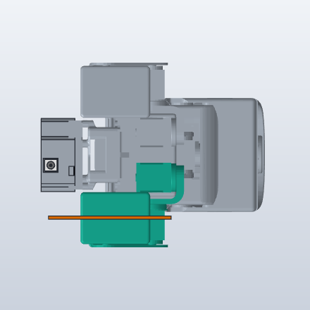<br><b>10 · hip yaw</b><br>Bottom view, front to the right. Foot points straight forward, parallel to the line.</td>
<td align="center">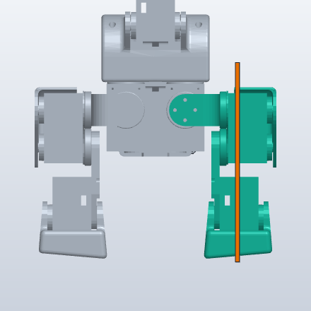<br><b>11 · hip roll</b><br>Front view. Leg hangs straight down, not splayed out or tucked in.</td>
<td align="center">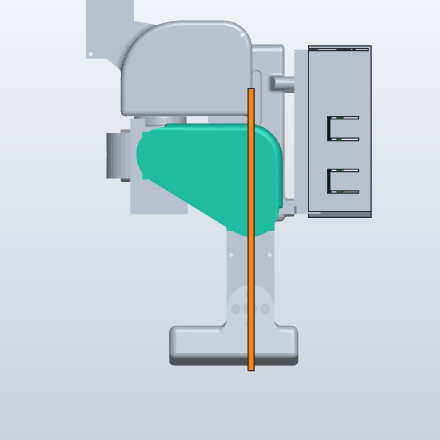<br><b>12 · hip pitch</b><br>Left side view. Thigh vertical, not swung forward or back.</td>
</tr>
<tr>
<td align="center">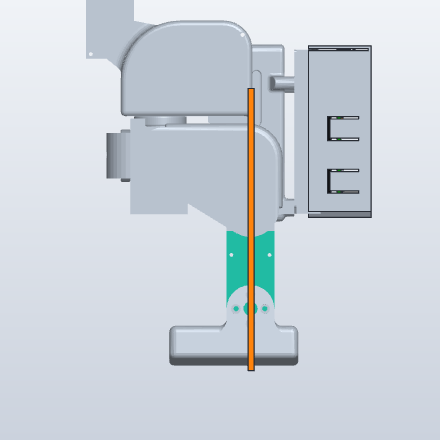<br><b>13 · knee</b><br>Left side view. Knee straight; shank in line with the thigh.</td>
<td align="center">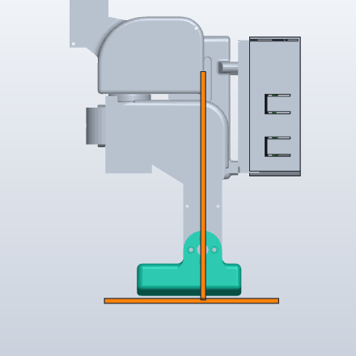<br><b>14 · ankle</b><br>Left side view. Sole flat along the horizontal line, square to the shank.</td>
<td></td>
</tr>
</table>

**Right leg (IDs 20–24)**

<table>
<tr>
<td align="center">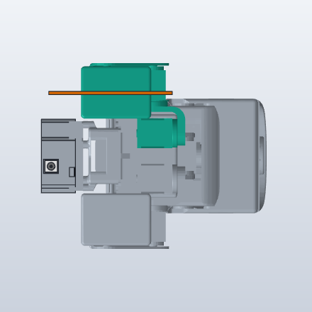<br><b>20 · hip yaw</b><br>Bottom view, front to the right. Foot points straight forward.</td>
<td align="center">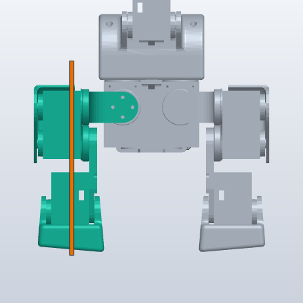<br><b>21 · hip roll</b><br>Front view. Leg hangs straight down.</td>
<td align="center">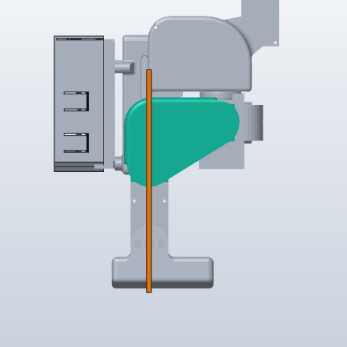<br><b>22 · hip pitch</b><br>Right side view. Thigh vertical.</td>
</tr>
<tr>
<td align="center">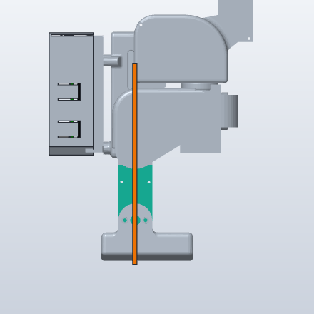<br><b>23 · knee</b><br>Right side view. Knee straight.</td>
<td align="center">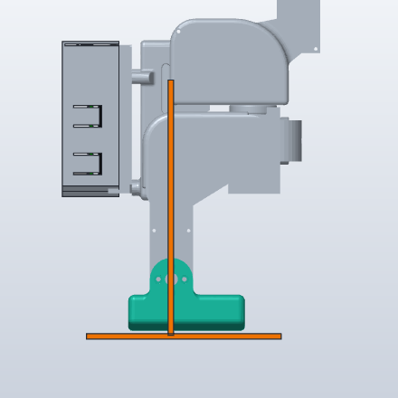<br><b>24 · ankle</b><br>Right side view. Sole flat, square to the shank.</td>
<td></td>
</tr>
</table>

**Neck, head and mouth (IDs 30–34)**

<table>
<tr>
<td align="center">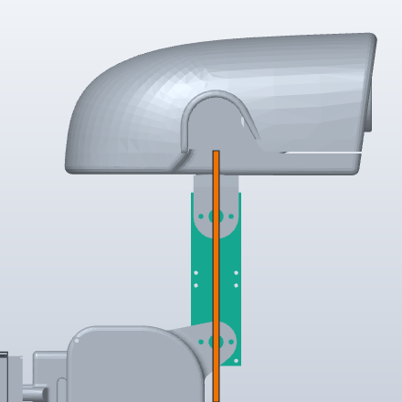<br><b>30 · neck pitch</b><br>Side view. Neck vertical; both neck pivots on the line.</td>
<td align="center">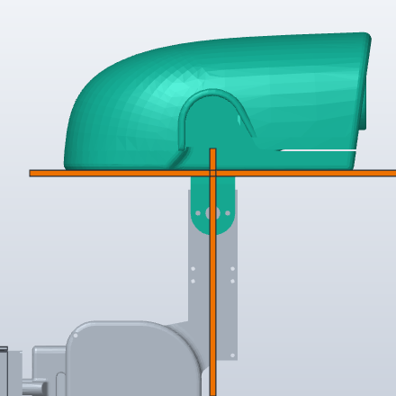<br><b>31 · head pitch</b><br>Side view. With the neck vertical, the head's underside is level.</td>
<td align="center">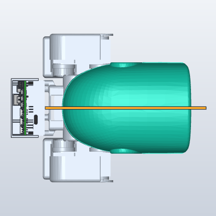<br><b>32 · head yaw</b><br>Top view, front to the right. Head faces straight forward.</td>
</tr>
<tr>
<td align="center">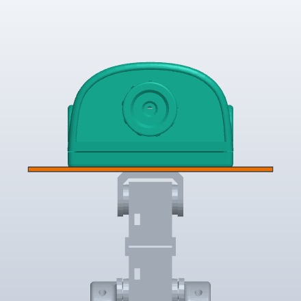<br><b>33 · head roll</b><br>Front view. Head level side to side.</td>
<td align="center">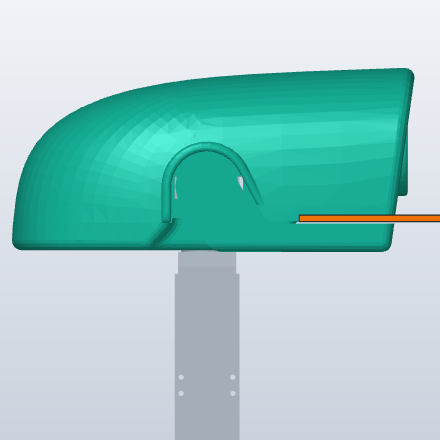<br><b>34 · mouth</b><br>Side view. Beak fully closed. The jaw is not a separate CAD part, so the whole head is teal; the line marks the beak seam.</td>
<td></td>
</tr>
</table>

### Step by step

1. **Open Calibration** (`/calibrate.html`) and press **Start calibration**. Policy and pose control stop. Torque stays **off**, so nothing moves yet, and each slider follows its joint's encoder.
2. **Select a joint.** Click its row, or use **←** and **→** in the **Zero pose** panel. The panel shows that joint's render and instruction, its encoder reading, its slider and its **Finish** button, so you do not need to scroll.
3. **Put the joint at zero**, matching the orange line in the render. Either:
   - move it by hand while it is unpowered, or
   - drag its slider. This powers **only that joint**, gently (KP = 3, KD = 0), starting from where it is. The MCU moves it toward the slider at about 35°/s and powers at most one new joint every 10 ms, so the servos never all start at once.
4. **Press Finish.** The servo's stored position offset is shifted so this pose reads **2048**, and 2048 is saved as the joint's zero (see [What Finish does](#what-finish-does)). A powered joint stays where it is. The row turns green and the panel moves on to the next joint.
5. **Repeat for all 15 joints.** Finishing a joint again replaces its zero with its current pose, so only press Finish when the joint is actually at zero.
6. **Fine-tune (optional, after every joint is calibrated).** Press **Move all to zero**. Every responding joint is powered in turn, moved slowly to its saved zero and held there at KP = 3. Check the whole robot against the renders, nudge any joint with its slider, and press **Finish** on it again. Joints that are missing or out of range are skipped and listed.
7. **Exit.** Torque turns off. Then, with the robot supported, test **Default pose** from the Control page before trying to walk.

A green row only marks joints finished during this visit. The saved zeros are in `data/zero_pos.json`, which is local to the robot and gitignored. After a full calibration every entry is 2048.

### What Finish does

Each servo reports its position as `(encoder - offset) mod 4096`, where the offset is stored in the servo (register 31). The horn can be fitted with a joint's zero anywhere on the encoder, including right at the wrap between 4095 and 0. A zero there leaves almost no room in one direction: the joint either cannot reach its target, or crosses the wrap and jumps.

So **Finish**, on the MCU:

1. reads the servo's current offset,
2. switches that joint's torque off, waits for the servo's reply, then unlocks the EEPROM and writes a new offset so the present pose reads 2048, reading it back and retrying up to three times,
3. re-holds the joint at 2048 if it was powered, so it does not move.

The host then waits for three fresh readings within 12 counts of 2048 before saving that as its zero. If the servo does not confirm within 1.2 s, Finish shows an error and the zero is left unchanged; press it again. Slider targets are held back while a Finish is confirmed. Every calibrated joint therefore sits mid-range, about ±180° from the wrap, however its horn was fitted.

To shift an offset by hand instead, enter Servo setup and post `{"action": "write_offset", "target_id": ID, "raw_pos": OFFSET}` to `/api/servo`, with `OFFSET = (reading + current offset - 2048) mod 4096`. `read_reg` with `new_id: 31` returns the current offset. Writing 0 removes the offset. The `set_middle` action (writing 128 to address 40, the STS midpoint command) did not change the reading on the HD-1910 servos tested.

### Offset check

The calibration itself lives in each servo (register 31), so a servo that loses it (a replaced servo, a factory reset, or a write that only reached RAM) points its zero somewhere else. Default pose then drives that joint hard toward the wrong angle, which can brown out the shield.

So the host keeps a reference copy of every servo's offset in `data/servo_offsets.json`:

- **Saved** when you exit Calibration or Servo setup, for the joints you finished or rewrote there, and on the first start for every servo.
- **Checked** at every start and whenever a servo answers again after more than 0.5 s of silence (its power came back and it reloaded its EEPROM). The check briefly enters Servo setup to read the registers; the mode shows **servo setup** for under a second. A power return during Default pose or Walk disarms first.
- **If a servo's offset differs**, Default pose and Walk are refused. The Control page explains which ID changed, and the Calibration page outlines that joint. Finish it at its zero, then exit Calibration to save the new value.

### Troubleshooting

| Symptom | What to do |
| --- | --- |
| A row shows **encoder … out of range** and its slider is locked | The joint is past the encoder wrap. Move it to zero by hand and press **Finish**; that re-centres it. |
| **Finish** reports that the joint *did not confirm the offset change* | The servo did not answer. Check its cable and the servo supply, then press Finish again. The zero was not changed. |
| Default pose and Walk are refused with *Servo calibration changed on ID …* | That servo's stored offset no longer matches its calibration (see [Offset check](#offset-check)). Recalibrate that joint and exit Calibration. |
| After a restart a joint goes back to where it was before calibrating | Its offset never reached the servo's EEPROM. Fixed in this firmware; recalibrate the joint once. |
| The Control page shows IMU **no data** | The IMU answers but reads zero, usually after a shield power loss. The firmware re-initialises it within about a second; Default pose and Walk are refused until it reports real data. |
| Encoder readings show **—** or rows stop updating | No servo replies. Check the battery, the servo supply and the cables; a loose head cable drops IDs 30–34. If the page shows no readings at all after an app update, the MCU may not have started: fully power-cycle the Uno Q. |
| The shield resets or the battery cuts out | Do not power many joints at once. Calibration only powers the joints you drag, one at a time. Recharge the pack if it has been cutting out. |
| Default pose does not stand | Check each joint against the renders with **Move all to zero**, and re-finish any that are off. |

## Joint direction check

A servo fitted the other way round still calibrates and can even hold Default pose: a hip pitch and ankle that are both reversed still give flat feet, just leaning the wrong way. The walk policy then gets mirrored feedback and falls within a step or two. The **Check** page (`/check.html`) finds this, with torque off.

1. Open **Check** and press **Torque off**.
2. For each IMU row, press **Start** and tilt or turn the whole robot as described. For each joint row, press **Start** and move only that joint 20–30° as described.
3. A row turns green when the robot measures the motion with the sign the policies were trained with, and red ("reversed") when it is mirrored.
4. On a red joint row press **Flip direction**, then run the row again to confirm it turns green.

The expected directions come from the Microduck model the policies were trained on (robot frame x forward, y left, z up; "left" and "right" are the robot's own):

| ID | Joint | Positive direction |
| --- | --- | --- |
| 10 / 20 | hip yaw | toes turn to the robot's right (left foot inward, right foot outward) |
| 11 / 21 | hip roll | feet move to the robot's left (left foot outward, right foot inward) |
| 12 / 22 | hip pitch | left foot swings backward, right foot swings forward |
| 13 / 23 | knee | left foot moves forward, right foot moves backward |
| 14 / 24 | ankle | left toe down, right toe up |
| 30 / 31 | neck / head pitch | neck tilts back / head tips nose-down |
| 32 / 33 | head yaw / roll | head turns left / left side goes down |
| 34 | mouth | beak opens |

IMU: nose-down gives positive gravity x; left side down gives positive gravity y. Turning left gives positive gyro z.

Flips are stored on the robot in `data/joint_signs.json` (gitignored), as the list of IDs that use direction +1 instead of the firmware default of −1. The host sends them to the MCU at startup, re-sends them if the MCU reports anything different (for example after an MCU reset), and refuses changes while torque is on. Calibration zeros are raw encoder values, so flipping a direction does not invalidate them. **Reset all directions** returns every joint to the default. A reversed IMU row cannot be flipped here; check how the board is mounted.

On the robot this fork was developed on, neck pitch (30) and head pitch (31) were reversed. Every other joint and the IMU matched.

## New or replacement board

Calibration lives in the servos, so it stays with the robot. These files hold the rest of the robot's settings, in `data/`: zeros, joint directions, walk tuning, controller mapping and the servo offset check. Before swapping an Uno Q, back them up from the computer:

```bash
sh tools/robot-data.sh backup
```

On the new board:

1. On the computer, `sh tools/check-sources.sh` checks that every Python module compiles and every page script parses. A syntax error in a page script silently stops the whole page. Then copy the app to `~/ArduinoApps/xgoduck`, for example `git archive --format=tar.gz -o xgoduck.tgz HEAD`, `adb push xgoduck.tgz /tmp/`, then `mkdir -p ~/ArduinoApps/xgoduck && tar -xzf /tmp/xgoduck.tgz -C ~/ArduinoApps/xgoduck` on the board.
2. Connect it to Wi-Fi. The first build downloads the pinned board core and the Python packages. A new board can also boot days behind, and HTTPS fails until its clock syncs.
3. On the board, from the app directory, run `sh tools/setup-board.sh`. It checks internet and the clock and enables lingering, which a fresh board lacks and the Bluetooth helper needs. It sets the router to 2 Mbps (asks for sudo), patches the Bridge libraries, installs the Bluetooth helper and makes this the app that starts at boot. It is safe to re-run, and lists anything left to do.
4. From the computer, `sh tools/robot-data.sh restore checkpoints/robot-data-<date>`, then start the app.

Without a backup, the defaults apply: recalibrate, then redo the Check page flips, IMU level and controller mapping. A paired controller must be paired again; bonds belong to the board.

## Running

Pinned stack: App CLI with Arduino Zephyr core 1.0.0, RouterBridge 0.4.3, RPClite 0.3.1, MsgPack 0.4.2. `sketch/sketch.yaml` lists those libraries, including the transitive ones. Python packages are installed by the App build from `python/requirements.txt`.

On the Uno Q, from this directory:

```bash
python3 tools/prepare-bridge.py
sudo bash tools/router-2m.sh
arduino-app-cli app start "$PWD"
```

`prepare-bridge.py` patches the resolved library cache and keeps the original headers as `.h.original`:

- RouterBridge 0.4.3: RPC thread stack 500 → 4096 bytes.
- RPClite 0.3.1: a bounded MessagePack scanner accepts a complete frame before `Unpacker::feed()`, and rejects a frame larger than the RPC buffer.

Re-run the script after a library-cache wipe or on a new board. If it cannot find the libraries, let the App CLI resolve `sketch.yaml` once, then run it again.

`router-2m.sh` sets the router serial rate to 2 Mbps in `/etc/systemd/system/arduino-router.service.d/90-xgoduck-baud.conf` and leaves the board GPIO ready-hook in place. That rate is global. Before starting another app that calls `Bridge.begin()` at 115200, move the drop-in aside, reload systemd, and restart `arduino-router`. Both ends must use the same rate. Restarting the router recreates its socket and resets the MCU, so stop this app first, restart the router, then start the app again. A normal app restart does not need a router restart.

If an isolated CLI build tries to re-download a toolchain that is already on the board and GitHub is unreachable, run `python3 tools/reuse-toolchain.py` and start the app again.

GCC 14 can tail-call `k_thread_name_set` at the end of `setup()` with a Thumb `JUMP24` from the loadable sketch into flash. The Uno Q loader then returns ENOEXEC (−8) and the MCU never starts. The `asm volatile("nop")` at the end of `setup()` keeps a long call. `python3 tools/verify-elf.py` checks the built ELF for the same class of short branch to an unresolved firmware symbol.

The web UI is served on port 9527. App Lab starts the same app under the name in `app.yaml`.

The app boots in **inference only**: the network runs, torque stays off. From the control page:

| Control | Effect |
| --- | --- |
| Inference only | Policy runs. Torque off. |
| Default pose | Holds the home pose. Requires a fresh MCU and IMU sample. |
| Walk / get up | Enables position control and the recovery state machine. |
| Pick | While upright in walk, runs `xgoduck_pick.onnx` for 4 s, then returns to walk. |
| Roulade | While upright in walk, runs `xgoduck_roulade.onnx` for 1.9 s, then returns to walk. |
| Torque off | Disables position control. |

Closing the page, or leaving it in the background for more than 1 second, turns position control off. Calibration and servo setup use a 2 second heartbeat and then exit and turn torque off.

Walk commands are vx ±0.4, vy ±0.3, ωz ±1.0, with a joystick dead zone of 0.1. The four head channels are ±1; see [Head in Default pose](#head-in-default-pose). Keyboard: W/S, A/D, Q/E, Space. A Bluetooth gamepad can also drive the robot; see [Bluetooth controller](#bluetooth-controller).

## Walk tuning

The **Walk tuning** section of the Control page matches this robot to the walking policy. Every setting is saved on the robot in `data/tuning.json` (gitignored) and applied immediately. The defaults reproduce the original runtime. Each setting is explained on the page as **What / Why / Tune**, and the same explanations are below. Change one thing at a time and compare the **Last walk** numbers.

### Battery and temperature

The section header shows the lowest servo supply voltage (register 62) and the hottest servo temperature (register 63). They are read with the 100 Hz status and reported at 5 Hz.

- **Why:** the XGO policies were trained with a 7.4–8.0 V supply (`xgoduck_rl/.../xgoduck_constants.py`, `vin_range`). Below that, servo torque, and with it walking, degrades. A flat pack also caused shield brownouts on the development robot, which reset the IMU.
- **Tune:** the readout turns amber below 7.4 V; charge before testing.

### Walk policy

- **What:** the ONNX walk model the robot runs. Any `python/xgoduck_walk*.onnx` can be chosen.
- **Why:** the original `xgoduck_walk.onnx` was trained without the battery and Uno Q at the back. Three retrains ([jimbruges/xgoduck_rl](https://github.com/jimbruges/xgoduck_rl)) use the robot's real mass, ±15 mm centre-of-mass randomisation and an 8–24 ms command delay. `xgoduck_walk_realcom.onnx` (branch `real-mass-com`) puts all the extra mass behind the body, so the centre of mass is 8 mm back. `xgoduck_walk_cadbattery.onnx` (branch `cad-battery`) places the battery inside the body and the Uno Q stack behind it, as in the CAD assembly, so the centre of mass is 3.7 mm back. `xgoduck_walk_backcover.onnx` (branch `back-cover`) models the screw-on back cover and battery mount at about 836 g, with the centre of mass 4.0 mm back; use it with that hardware.
- **Tune:** compare both on the same walk using **Last walk**. Use Home pose **Model**, so each policy uses the home it was trained with (22° for the retrained one). It may need less Home lean. Switch only while not walking.

To retrain: in the xgoduck_rl fork, run `uv run hf auth login`, then `uv run train Mjlab-Velocity-Flat-XgoDuck --env.scene.num-envs 4096 --agent.max_iterations 4000 --hf-jobs --no-wandb`. Download the final `model_*.pt` from the checkpoint repo and export it with `uv run python scripts/export.py Mjlab-Velocity-Flat-XgoDuck --checkpoint-file <model.pt> --onnx-file xgoduck_walk_<name>.onnx`. Then load it onto the robot with **Upload policy**.

**Upload policy** (on the Walk policy card) sends an `.onnx` from the computer to the robot (`POST /api/walk_model/upload`). Before saving it to `python/`, the robot checks:
- it loads with observation [1,61] and action [1,14];
- its metadata has the same joint order as the current walk policy and a trained home (`default_joint_pos`), which Home pose **Model** needs. An export from `scripts/export.py` has both.

The name gets an `xgoduck_walk_` prefix if it lacks one. An existing file is only overwritten with **Replace** ticked, never the policy in use and never the original `xgoduck_walk.onnx`. Uploading does not switch to the policy; the page offers to switch afterwards. Uploaded policies live only on the robot and are not in git.

### Home pose (Table / Model)

- **What:** the joint pose the policy measures its observations from and adds its actions to.
- **Why:** each ONNX model records the home it was trained around (`default_joint_pos`): walk, get-up and pick were trained at 20° hip pitch and ankle, roulade at 24°. The original runtime used one hand-tuned 23° (`HOME_DEG`) for all of them, so walk saw its hips and ankles 3° off. **Model** uses each policy's own trained home.
- **Tune:** prefer **Model**. Switch only while not walking.

### Home lean (standing and forward / walking backward)

- **What:** stands the hip pitch and ankle home angles this many degrees more upright. The hip and ankle move together, so the feet stay flat. That moves the body forward over the feet by about 1.3 mm per degree, in every policy's home and in Default pose. The applied lean blends from the standing/forward value to the backward value as the walk command goes from 0 to −0.2 backward, changing at most 20°/s (0.4° per tick) so the policy's joint observations never jump. Default pose follows the same slewed lean.
- **Why:** the XGO training model (`xgoduck_rl/src/mjlab_microduck/robot/xgoduck/`) has no Uno Q, shield or battery. Its SolidWorks parts list for the trunk has none of them, and the 68 g added to its trunk mass sits near the trunk centre. On the robot the Uno Q, shield and cover sit behind the body, and the battery sits inside the body in front of them (CAD assembly). That puts the real centre of mass an estimated 4 mm behind the trained one; the home lean the robot needed suggests more. Training randomised the centre of mass by only ±3 mm, ramping to ±8 mm, and switched mass randomisation off. The robot walked forward but fell when walking backward. Measured: backward walking needed 9–10° of lean (about 12 mm), and that much lean made forward walking unstable, hence two values.
- **Tune:** set the forward value to the most lean that keeps forward walking steady (start at 0). Raise the backward value until backward walking holds. The real fixes are to move the battery forward or retrain with the true centre of mass.

### IMU level

- **What:** the IMU's mounting roll and pitch, cancelled before the tilt estimate the policy uses for balance.
- **Why:** training randomised the IMU mount by up to 6° about a random axis. A systematic board tilt has to be corrected on the robot. Measured with a spirit level, the development robot's IMU sits about 4° nose-up.
- **Tune:** turn torque off and hold the robot so a spirit level (or phone level app) on the body's flat top reads level front-to-back and side-to-side. Keep it still and press **Level IMU**. It averages 1 s and refuses if the robot moves, isn't at about 1 g, or is tilted more than 30°. **Reset** clears it. Don't level in Default pose: head weight and servo sag tilt the body there, and levelling that way hid a real backward lean (−5.4°) and made the robot fall backward.

### Command smoothing

- **What:** a first-order low-pass on the walk and head commands, as a time constant (0–0.5 s).
- **Why:** policies are trained on smoothly varying commands, while a gamepad gives steps. Upstream Microduck smooths its commands the same way.
- **Tune:** 0.1–0.2 s. Longer feels sluggish.

### Servo KP / KD

- **What:** the run gains of every joint servo in Default pose and Walk: the servos' temporary KP/KD registers, 50 and 51. Defaults are KP 6 and KD 20. They are applied live, echoed back by the MCU, and resent if they differ.
- **Why:** the flight recorder showed the legs achieving only about 40–50% of each commanded swing, about 85 ms late; the policy then over-corrects. Training assumed servo P = 5 (`kp_fw=5`) and a 4 ms command delay. Upstream Microduck runs its servos with no damping, because damping makes them slow.
- **Tune:** one step at a time (KP +2, or KD −6): **Clear**, walk the same sequence, compare **Last walk**. Stop if a servo buzzes, the robot shakes while standing, or a temperature climbs past about 50 °C.

### Supply guard

- **What:** the threshold below which every servo's torque is capped, and how much torque is kept. 0.6 V lower it caps at 20 %; *Turn off* disables it. See [Power cuts when falling](#power-cuts-when-falling-supply-guard).
- **Why:** the battery sags under load, and a backward fall took it to 5.8 V, where the power protection cut out and latched off.
- **Tune:** defaults 6.5 V and 70 %, which kept power on falls and walked well at full speed on the development robot. If walking is weak, lower the threshold or keep more torque; if falls cut the power again, step back.

### Black box (power cuts)

The flight recorder lives in memory and is lost in a power cut. So the app also writes a compact record about 20 times a second to `data/blackbox/current.jsonl` and syncs it to storage every 0.25 s. Each record holds the mode, recovery phase, tilt, peak acceleration and rotation rate, how many servos answered, servo supply voltage (min and max) and the hottest servo. At each start the previous run's file becomes `previous.jsonl`, so after an unexpected power-off it ends at the cut. Read it at `/api/blackbox/previous` (the last 30 s), or this run's at `/api/blackbox/current`.

What to look for: a supply voltage that sags under load before the end points at a current or protection trip. Steady voltage until a sudden end at an impact points at the power path being knocked: a switch, the battery contacts or a connector.

### Power cuts when falling (supply guard)

**What was found.** On the development robot the whole robot lost power on backward falls and stayed off until the power switch was cycled. Replacing the Uno Q did not help. The black box showed the cause is the supply, not the board or a loose connection:

| Moment | Lowest servo supply |
| --- | --- |
| Resting, torque off | 8.0–8.1 V |
| Walking (median) | 7.5 V |
| Hard steps | dips to 6.5–6.9 V |
| Last 0.1 s, tipping backward past 36° with the legs swinging at up to 850°/s | 5.8 V, then the record ends |

All 15 servos answered to the last record, so nothing came loose. The supply sagged, and the power protection (most likely the 2S pack's BMS) cut out and latched off. The cut came before the fall detector fired (55° for 0.15 s), so it is the walk policy fighting the fall that draws the spike. A sag of 2 V or more means a few tenths of an ohm in the power path, far more than good high-drain cells and a properly rated BMS have.

**Hardware fix (recommended).** With a multimeter across the battery while the robot walks or stamps:

- If the battery itself drops about 2 V, the cells or the BMS are the limit. Use high-drain cells (for example Molicel P26A, Samsung 25R or 30Q) and a 2S BMS rated for at least 10 A continuous.
- If the battery stays near 8 V while the servos report 6 V, look at the wiring and connectors between the battery and the servos.

**Supply guard (firmware, set in Walk tuning).** While Default pose or Walk is on, the MCU checks every servo's supply voltage each 10 ms tick. Two settings on the Control page's **Supply guard** card control it (defaults 6.5 V and 70 %):

- Below the **threshold**, every servo's torque limit (register 48) drops to the **torque kept** setting.
- 0.6 V below the threshold, it drops to 20 % (or the torque setting, if lower), close to limp but still holding position.
- Once every servo reads 0.5 V above the threshold for 0.3 s, the limit steps back up one level at a time.
- With torque off, and in calibration and servo setup, the limit is always 100 %. **Turn off** disables the guard.

Capping torque caps the current, so the supply recovers instead of reaching the protection's cut-off. Both settings travel with the servo gains, and the card shows *applied* once the MCU has echoed them back. The Control page shows *torque limited (supply low)* next to the battery figure while it is active, and how many times it has triggered. The black box logs it as `lim` (0, 1 or 2).

Trade-off: the development robot's pack dips below 6.8 V on hard steps. At first the guard was set at 6.8 V and 50 %: it also limited torque during normal walking, and the robot fell on its face at full speed. At 6.5 V and 70 %, now the defaults, it kept power on falls and walked well at full speed. A lower threshold or more torque gives stronger walking but more risk of a cut on falls. Frequent triggers while walking mean the supply needs fixing.

### Last walk

- **What:** a summary of the flight recorder (`GET /api/log/summary`). For walking forward, backward, turning and standing it gives the follow ratio (achieved over commanded leg swing, 1.0 = all of it) and the delay, plus falls and the resting pitch. It covers all walking in the recorder's last 20 s and updates every 2 s.
- **Why:** it turns "it falls" into numbers that can be compared between settings. Most of the findings below came from it.
- **Tune:** press **Clear** before each change.

### Action smoothing

- **What:** a low-pass on the policy's output. Each tick keeps α of the previous action; 0 means no filtering.
- **Why:** it is kept at the reference deployment's 0.45. Upstream Microduck disagrees with itself here: its training repo says the policies are trained unfiltered, but its runtime filters with α = 0.7 on the legs and 0.5 on the head. The XGO training repo doesn't say. Filtering adds delay on top of the servos' delay.
- **Tune:** if walking is late to catch a stumble, try a lower leg α (0.3, then 0.15); if it jitters, raise it.

### What was found on the development robot

In the order the problems were found:

1. **Neck pitch and head pitch were mounted reversed.** The walk policy uses the heavy head to balance, so it was correcting the wrong way. Fixed on the **Check** page.
2. **Calibration zeros were lost at startup.** A second calibration message overwrote the zeros before the MCU read them. The host now resends them until the MCU confirms.
3. **The IMU had been dead after a shield brownout.** It kept answering, but read zero, while reporting OK, so the policy walked with no balance feedback. The firmware now re-initialises the IMU.
4. **The servos follow only about half of each commanded swing, about 85 ms late** (see Servo KP/KD).
5. **The centre of mass is behind the trained one** (see Home lean).

With 1–3 fixed and the IMU levelled, the robot walked forward at up to vx 0.39 without falling. It still fell walking backward until about 9–10° of backward lean was applied.

### Suggested procedure

1. Charge the battery (≥ 7.8 V) and use the same flat floor each time.
2. Level the IMU against a spirit level once.
3. Set **Home pose** to Model and command smoothing to 0.15 s.
4. Find the forward lean, then the backward lean.
5. Then try the servo gains, one step at a time, using **Last walk** to compare.

## Bluetooth controller

A Bluetooth gamepad can drive the robot, and the **Controller** page (`/controller.html`) pairs it and sets what each button and stick does.

### How it is wired

The App Lab container cannot reach BlueZ or `/dev/input`. App Lab generates its Docker settings without the `input` group, the input device class or the D-Bus socket, and regenerates them on every start. So a small helper runs on the Uno Q host instead:

```text
gamepad ── Bluetooth ──> BlueZ ──> /dev/input/eventN
                                        │
              host/pad_helper.py  (user service xgoduck-pad, port 9528)
                │  POST /api/pad at 50 Hz              ▲ /bt/* pairing calls
                ▼                                      │
              app container  ── /api/bt/* proxy ───────┘  (msgpack-rpc-router = host gateway)
```

`host/pad_helper.py` uses only the standard library. It pairs, trusts, connects and forgets devices through `bluetoothctl`, reads the first connected gamepad's input events, and posts the button and stick state to the app. It accepts HTTP only from loopback and Docker bridge addresses.

Install it once on the board (no sudo needed: user services start at boot because lingering is enabled for `arduino`):

```bash
tools/install-pad-helper.sh
```

### Pairing

1. Open **Controller** and press **Pair new controller**.
2. Within 60 s, put the controller in pairing mode. The page pairs the first gamepad that starts advertising, then trusts and connects it.
3. A paired controller reconnects by itself whenever it is switched on.

**Scan** lists nearby named devices; **Pair & connect**, **Connect**, **Disconnect** and **Forget** act on one. Pairing switches the adapter to pairable first. Without that, BlueZ pairs without storing a bond and then rejects the controller's HID connection ("Rejected connection from !bonded device").

Use the controller's **Android** or generic HID mode. This board's kernel has no `hid-playstation`, `hid-sony` or `hid-nintendo` driver, and `/dev/hidraw*` is root-only. Modes that imitate a DualShock 4 (often labelled PC or PS4) or a Switch Pro controller pair, but send no input. Controllers can use a different Bluetooth address in each mode.

| GameSir Nova Lite | Combo, from off | LED | Works |
| --- | --- | --- | --- |
| Android | A + Home | yellow, fast blink | yes |
| PC | B + Home | blue | no (DualShock 4 imitation) |
| Switch | Y + Home | red | no (Switch Pro imitation) |

The Nova Lite leaves pairing mode after about a minute if nothing connects.

### Mapping

The **Live input** panel shows each button's name as you press it, and each axis value as you move a stick or trigger. The matching mapping row lights up. Mappings are saved on the robot in `data/controller.json`.

| Button action | Effect |
| --- | --- |
| Torque off, Inference only, Default pose, Walk / get up | Switch mode, once per press. |
| Pick, Roulade | Start that move, once per press. Same rules as the Control page. |
| Open mouth (hold) | Mouth fully open while held. |
| Half speed (hold) | Halve forward, strafe and turn while held. |

| Axis target | Range |
| --- | --- |
| Forward / back, Strafe, Turn | Full stick = vx ±0.4, vy ±0.3, ωz ±1.0. |
| Neck pitch, Head pitch, Head yaw, Head roll | ±1, see below. |
| Mouth | 0–30°, linear over the trigger's travel. |

Stick axes run −1 to +1, with up and left negative. Analog triggers reported as `gas` or `brake` run 0 (released) to 1. Tick **Invert** if an axis moves the robot the wrong way, and **Trigger** for an axis that rests at −1 (some pads report triggers as `lz` or `rz`). The deadzone applies to sticks.

Default mapping:

| Input | Action |
| --- | --- |
| south (A) | Walk / get up |
| east (B) | Torque off |
| west, north | Pick, Roulade |
| start | Default pose |
| select | Inference only |
| l1 | Open mouth (hold) |
| r1 | Half speed (hold) |
| left stick | Forward / back and strafe |
| right stick, horizontal | Turn |

### Behaviour and safety

- While a controller is sending input, its sticks drive motion and the Control page's joysticks and head sliders are ignored. The page mirrors the controller's commands instead.
- A connected controller also counts as the heartbeat, so Default pose and Walk stay enabled without the page open.
- If the controller disconnects, or the helper stops, motion zeroes within 0.3 s. Without a page open, position control turns off after 1 s.
- Calibration and Servo setup ignore the controller.

### If the controller stops reconnecting

The helper checks the adapter every 10 s and powers it back on if it is off. The Controller page's adapter line shows the last power event, and the helper logs it (`journalctl --user -u xgoduck-pad` on the board).

After a long uptime (about 20 minutes on the development robot) the Uno Q's Qualcomm Bluetooth core can crash. The kernel log shows `hci0: command 0x0405 tx timeout`, then `Reading QCA version information failed`. The adapter then cannot be powered on, so a paired controller can never reconnect. After a minute of this the Controller page says *the Bluetooth chip has stopped responding; restart the Uno Q*. Restarting the Uno Q recovers it; rebinding the `hci_uart_qca` driver did not. The same chip also does Wi-Fi, which can stop passing traffic at the same time. Reconnecting Wi-Fi (`nmcli connection up <network>`) recovered that without a restart.

### Head in Default pose

The four head channels are neck pitch, head pitch, head yaw and head roll (IDs 30–33).

- **Walk:** they are inputs to the walk policy, which decides how far the head follows.
- **Default pose:** there is no policy, so they move those joints directly from the default angles. ±1 gives ±30°, ±35°, ±60° and ±20° respectively, at most 2° per 20 ms tick (100°/s).

This applies whether the head is set from the Control page or the controller.

## Policies

Models in `python/`:

- `xgoduck_walk.onnx`
- `xgoduck_getup.onnx`
- `xgoduck_pick.onnx`
- `xgoduck_roulade.onnx`

Each expects observation `[1, 61]` and emits action `[1, 14]`. All four are loaded and warmed at startup. Spare time in the 50 Hz loop runs one dummy pass on an idle session so a switch does not pay a cold start.

Observation layout: gyro (rad/s), gravity, 14 joint positions relative to home, 14 joint velocities, previous action, twist (3), head (4), and six zeros.

Recovery, evaluated on the 50 Hz clock:

- Tilt above 55° for 0.15 s → get-up model, action forced to 0 for 1 s, then the get-up action. Twist and head are zero.
- Tilt below 15° for 1 s → walk, and the web twist/head/mouth commands apply again.
- Pick, only from upright walk: command `[cos(2πφ), sin(2πφ), 0]` plus ten zeros, `φ` advances by `dt/4` (a 4 s cycle). The mouth opens to 30° and closes when φ ≥ 0.4.
- Roulade, only from upright walk: runs for 1.9 s with twist, head, and the six trailing command inputs at 0. Gyro, gravity, joint position, joint velocity, and the previous action stay on the usual path. Leg and neck smoothing drop to α = 0.15 for that window, then return to the previous values. Tilt does not select get-up until the 1.9 s ends.

Action smoothing uses α = 0.45 on slices `[0:5]`, `[5:10]`, and `[10:14]`. `prev_action` stores the raw network output and is cleared on a policy switch. The 1 s fallen hold sends the home pose directly and does not keep a filtered walk action. Gyro smoothing α = 0.5, joint-velocity α = 0.4, gravity complementary-filter τ = 0.3 s. Accelerometer correction falls off when the norm leaves 1 g by more than about 20%. There is no gyro bias subtraction. The QMI axes are mapped once, in firmware; the host undoes the reference device mapping so the filter matches the Microduck math without applying that mapping twice.

Position control stops if commands are absent for 250 ms or the IMU is absent for 100 ms. Enabling again takes an explicit mode change. Host feedback older than 150 ms also disarms; that matches the MCU source-age limit.

## Layout

```text
app.yaml                 App Lab manifest
assets/                  Web UI
assets/cal/              CAD zero-pose renders for calibration (j<ID>.png)
assets/calguide.js       Zero-pose text and image per joint
python/                  Host policy, Bridge client, ONNX models
sketch/                  STM32 firmware
data/zero_pos.json       Created on the robot by calibration (not in git)
tools/                   Bridge patch, router rate, ELF check, read-only capture
host/                    Bluetooth gamepad helper and its systemd user unit (runs on the host)
data/controller.json     Controller mapping, saved from the Controller page (not in git)
data/joint_signs.json    Joints mounted reversed, set on the Check page (not in git)
data/tuning.json         Walk tuning (home pose, command smoothing, IMU level), saved from the Control page (not in git)
FORK.md                  What this fork changes from upstream
```

## Checks

```bash
python tools/measure.py --seconds 60
```

`tools/measure.py` only reads `http://127.0.0.1:9527/api/status`. It does not enable motors. Pass `--output` to save a JSON capture.

## References

- [Microduck](https://github.com/pollen-robotics/microduck)
- [Arduino RouterBridge](https://github.com/arduino-libraries/Arduino_RouterBridge)
- [Arduino Router](https://github.com/arduino/arduino-router)
